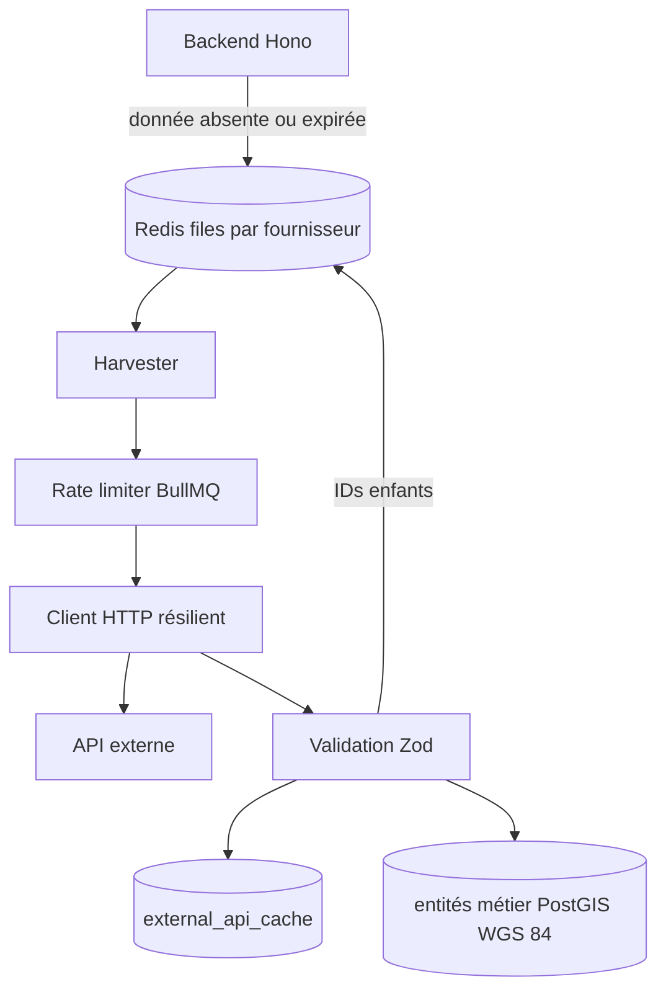

# Conteneur Harvester — Ingestion Asynchrone & Anti-Corruption

> **Statut :** Socle implémenté — adaptateurs métier à ajouter
> **Dernière mise à jour :** 2026-11-01
> **Point d'entrée :** `harvester/src/index.ts`
> **Voir aussi :** [`Spécification Technique du Conteneur Harvester.md`](./Spécification%20Technique%20du%20Conteneur%20Harvester.md) · [`api-cache.md`](./api-cache.md)

## 1. Objectif

Le harvester est le **moteur d'ingestion asynchrone** de la plateforme. Il décharge l'API Hono de tout appel externe bloquant, lisse le débit selon les quotas de chaque fournisseur, valide les payloads hétérogènes, les normalise et les persiste de façon idempotente dans PostgreSQL/PostGIS.

## 2. Portée et non-objectifs

- **Inclus :** files Redis par fournisseur, rate-limiting, retries avec backoff, cache brut, validation Zod, upsert PostGIS, hydratation des sous-ressources, supervision et arrêt propre.
- **Exclus :** logique de rendu frontend, authentification, endpoints métier Hono, migrations de base.

## 3. Place dans l'architecture



## 4. Structure réelle

```text
harvester/
├── Dockerfile
├── docker-entrypoint.sh
├── package.json
├── tsconfig.json
└── src/
    ├── index.ts                    # amorçage, santé :3001, arrêt propre
    ├── config/redis.ts             # REDIS_URL -> options BullMQ
    ├── db/client.ts                # pool postgres.js + Drizzle
    ├── db/schema.ts                # ré-export du schéma partagé (shared-db)
    ├── core/base-adapter.ts        # contrat BaseAdapter / JobPayload
    ├── core/queue-manager.ts       # files, jobId idempotent, workers
    ├── core/http-client.ts         # retry, timeout, 429, user-agent
    └── adapters/
        ├── example.adapter.ts      # démonstration complète
        └── example-photo.adapter.ts # sous-ressource enfant
```

Le schéma Drizzle n'est jamais dupliqué : `harvester/src/db/schema.ts` ré-exporte `shared-db/schema.ts`. En local, `harvester/shared-db` pointe vers `backend/src/db` ; dans Compose, ce dossier est monté en lecture seule (`:ro,z`) sur `/app/shared-db`. La source de vérité reste `backend/src/db/schema.ts`.

## 5. Flux d'un job

1. L'API pousse `{ externalId, parentId? }` via `dispatchNextJob`.
2. BullMQ applique la limite `max / durationMs` propre à l'adaptateur.
3. L'adaptateur appelle l'API externe avec `fetchJson`.
4. Le payload brut est validé par Zod.
5. Le brut est upserté dans `external_api_cache`.
6. L'entité normalisée est upsertée sur `(source, external_id)`.
7. Les identifiants enfants sont reprogrammés dans les files secondaires.
8. Le job est marqué terminé ; en cas d'échec, BullMQ réessaie avec backoff exponentiel (5 tentatives par défaut).

## 6. Contrat d'adaptateur

Un adaptateur implémente `BaseAdapter` :

| Champ | Rôle |
| :---- | :---- |
| `name` | Nom stable, utilisé comme nom de file (`harvest-<name>`). |
| `rateLimit` | `{ max, durationMs }` imposé par le fournisseur. |
| `concurrency` | Parallélisme local (défaut : 1). |
| `execute(payload)` | Une tentative : fetch, validation, cache, upsert, enfants. |

Règles :

- Les jobs ne transportent que des identifiants, jamais de payload métier.
- `jobId` = hash de `<adapter>|<parentId|root>|<externalId>|<fenêtre de 60 s>` : déduplique les rafales sans bloquer un rafraîchissement ultérieur.
- BullMQ interdit `:` dans les noms de file et les `jobId` : les noms sont normalisés et les identifiants hachés.
- Un `429` lève `HttpError` avec `retryAfterMs` ; le worker met la file en pause avant de réessayer.
- Une erreur de configuration lève `AdapterError` avec un code explicite.

## 7. Adaptateur de démonstration

`example.adapter.ts` illustre le cycle complet : validation, cache 24 h, conversion `longitude/latitude` en géométrie `SRID=4326`, upsert métier et dispatch des photos enfants. Il est **désactivé par défaut**.

Activation locale :

```bash
HARVESTER_ENABLE_EXAMPLE=1 \
HARVESTER_EXAMPLE_URL=https://exemple.test/api \
npm run dev
```

## 8. Variables d'environnement

| Variable | Rôle | Défaut |
| :---- | :---- | :---- |
| `DATABASE_URL` | Connexion PostgreSQL/PostGIS | requis |
| `REDIS_URL` | Connexion Redis | `redis://127.0.0.1:6379` |
| `HARVESTER_PORT` | Port de la sonde `/health` | `3001` |
| `HARVESTER_DB_POOL` | Taille du pool PostgreSQL | `5` |
| `HARVESTER_ENABLE_EXAMPLE` | Active les adaptateurs de démo | `0` |
| `HARVESTER_EXAMPLE_URL` | Base URL de l'API de démo | vide |

## 9. Supervision et arrêt propre

- `GET /health` renvoie `status`, `service`, `redis`, `adapters`, `uptime`.
- Compose vérifie cette sonde toutes les 10 s.
- `SIGINT` / `SIGTERM` : fermeture des workers (jobs actifs terminés), des files, puis du pool PostgreSQL. Un garde-fou force la sortie après 10 s.
- Redis est persistant (`appendonly yes`) dans `./data/redis` avec étiquette SELinux `:z`.

## 10. Ajouter un adaptateur réel

1. Créer `harvester/src/adapters/<source>.adapter.ts` depuis le modèle `example.adapter.ts`.
2. Définir un schéma Zod strict du format brut.
3. Renseigner `rateLimit` d'après la documentation du fournisseur.
4. Upserter le brut dans `externalApiCache` puis l'entité métier.
5. Dispatcher les sous-ressources via `dispatchNextJob`.
6. Enregistrer l'adaptateur dans `src/index.ts` et l'activer par variable d'environnement.
7. Ajouter les tests d'idempotence et de rate-limit.

## 11. Tests

- **Unitaire :** parsing Zod, construction de l'URL, calcul du `retryAfterMs`, `jobId`.
- **Intégration :** deux exécutions identiques ne créent qu'une ligne métier.
- **Rate-limit :** un 429 met la file en pause et ne produit pas de rafale.
- **Enfants :** un job parent crée exactement les jobs enfants attendus.
- **Arrêt :** `SIGTERM` pendant un job actif attend sa fin puis ferme Redis et PostgreSQL.

## 12. Fichiers concernés

- `harvester/src/index.ts`
- `harvester/src/core/queue-manager.ts`
- `harvester/src/core/http-client.ts`
- `harvester/src/core/base-adapter.ts`
- `harvester/src/adapters/example.adapter.ts`
- `harvester/src/adapters/example-photo.adapter.ts`
- `backend/src/db/schema.ts`
- `compose.yaml`

## 13. Prochaines étapes

- [ ] Implémenter un premier adaptateur réel (SIRENE, Open Data SNCF ou OSM Overpass).
- [ ] Ajouter les migrations Drizzle et l'extension PostGIS.
- [ ] Ajouter un tableau de bord de supervision des files (complétées, échouées, en pause).
- [ ] Ajouter des tests d'intégration avec un Redis éphémère.
