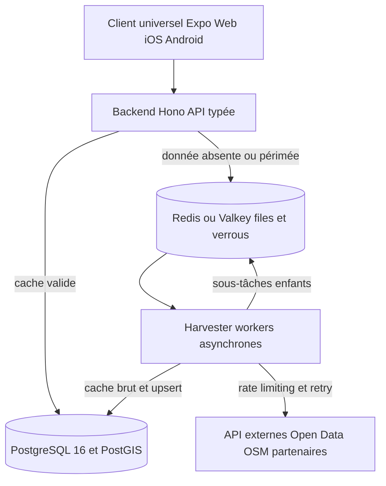

# Sommaire du Projet — The Universal Stack

> **Point d'entrée unique** pour comprendre, lancer et faire évoluer la plateforme.
> **Dernière mise à jour :** 2026-11-01
> **Voir aussi :** [Sommaire de la documentation](./sommaire_docs.md) · [État d'avancement](./avancement_projet.md)

## 1. En une phrase

Une plateforme **full-TypeScript**, **AI-Native**, **file-based** et **spatiale par défaut**, qui assemble et normalise des données publiques externes pour les rendre disponibles sur Web, iOS et Android, sans jamais inventer de donnée centrale.

## 2. Principes directeurs

| Principe | Conséquence concrète |
| :---- | :---- |
| **Souveraineté des données** | Aucune donnée centrale n'est créée localement ; elle provient de référentiels externes identifiés par `source` + `external_id`. |
| **Local-first** | La base locale est la source de vérité primaire ; le réseau ne sert qu'à compléter ou rafraîchir. |
| **Asynchrone par défaut** | L'API répond immédiatement (cache ou `202 Accepted`) ; le harvester exécute les appels lourds en arrière-plan. |
| **Idempotence** | Toute écriture utilise un upsert `ON CONFLICT DO UPDATE` ; rejouer un job ne crée aucun doublon. |
| **Dégradation gracieuse** | Une panne externe sert le cache local et affiche un état explicite, jamais un écran blanc. |
| **Portabilité** | Un dossier autonome, `./start.sh` comme seul point d'entrée, Podman rootless ou Docker. |

## 3. Architecture en un coup d'œil



## 4. Composants

| Composant | Technologie | Responsabilité | Emplacement |
| :---- | :---- | :---- | :---- |
| **Frontend universel** | Expo / React Native / Expo Router | SPA Web, applications iOS/Android, routage file-based, SSR/SEO | `frontend/` |
| **Backend API** | Hono + Drizzle ORM | API typée, santé, lecture/écriture métier, push de jobs | `backend/` |
| **Harvester** | Node.js + BullMQ + Zod | Ingestion asynchrone, ACL, rate-limiting, normalisation, hydratation des enfants | `harvester/` |
| **Files & verrous** | Redis 7 | Files par fournisseur, débits, reprises, idempotence | service Compose `redis` |
| **Persistance** | PostgreSQL 16 + PostGIS | Données métier, cache brut, géométries WGS 84 (SRID 4326) | service Compose `database`, `database/` |
| **Bootstrap** | Bash | Installation des dépendances, `.env`, lancement et arrêt propre | `start.sh`, `scripts/` |
| **Documentation** | Markdown | Référence, fonctionnalités, bonnes et mauvaises pratiques | `docs/` |

## 5. Flux de données

1. Le client demande une ressource à l'API Hono.
2. L'API vérifie la fraîcheur en base locale.
3. Si la donnée est valide, elle est servie immédiatement.
4. Sinon, l'API pousse un job dans Redis et renvoie `202 Accepted` (ou un cache périmé).
5. Le harvester dépile le job selon le débit du fournisseur, valide le payload avec Zod et normalise les coordonnées en WGS 84.
6. Le payload brut est conservé dans `external_api_cache`, la donnée métier est upsertée.
7. Les identifiants enfants sont reprogrammés dans les files secondaires.
8. Le client est notifié ou revalide en arrière-plan.

## 6. Arborescence de référence

```text
equilibred/
├── backend/                 # API Hono + schéma Drizzle partagé
│   └── src/
│       ├── index.ts         # serveur HTTP, sonde /health
│       └── db/schema.ts     # source de vérité du schéma (partagé)
├── harvester/               # worker d'ingestion asynchrone
│   └── src/
│       ├── index.ts         # amorçage, supervision, arrêt propre
│       ├── config/          # connexion Redis
│       ├── core/            # contrat, files, client HTTP
│       ├── db/              # client Drizzle + lien vers le schéma partagé
│       └── adapters/        # un fichier par fournisseur
├── frontend/                # Expo Router (Web, iOS, Android)
├── database/                # données PostgreSQL persistantes
├── docs/                    # documentation par fonctionnalité
├── scripts/                 # bootstrap et préparation de l'environnement
├── compose.yaml             # backend, harvester, redis, database
└── start.sh                 # lancement automatique, sans option
```

## 7. Démarrage rapide

```bash
./start.sh
```

Le script installe les dépendances manquantes, prépare `.env` et les volumes, démarre PostgreSQL/PostGIS, Redis, le backend et le harvester, attend la santé de l'API, puis lance Expo :

- `w` : navigateur Web ;
- `a` : émulateur ou appareil Android ;
- `i` : simulateur iOS (macOS) ;
- `Ctrl-C` : arrêt propre d'Expo et de toute l'infrastructure.

## 8. Variables d'environnement principales

| Variable | Rôle | Défaut |
| :---- | :---- | :---- |
| `API_PORT` | Port de l'API Hono | `3000` |
| `PORT` | Port Expo / Metro | `8081` |
| `DB_PORT` | Port PostgreSQL exposé | `5432` |
| `DATABASE_URL` | Connexion PostgreSQL interne | construite depuis les identifiants |
| `REDIS_PORT` | Port Redis exposé | `6379` |
| `REDIS_URL` | Connexion Redis du harvester | `redis://redis:6379` |
| `HARVESTER_PORT` | Sonde `/health` du harvester | `3001` |
| `HARVESTER_DB_POOL` | Taille du pool PostgreSQL du worker | `5` |
| `HARVESTER_ENABLE_EXAMPLE` | Active les adaptateurs de démonstration | `0` |
| `HARVESTER_EXAMPLE_URL` | Base URL de l'API de démonstration | vide |
| `AUTH_SECRET` | Secret de session serveur | généré pour la session |
| `EXPO_PUBLIC_API_URL` | URL publique de l'API pour le frontend | `http://localhost:3000` |

> Seules les variables `EXPO_PUBLIC_*` sont transmises au frontend. Les secrets serveur restent dans le conteneur backend ou harvester.

## 9. Conventions et garde-fous

- **Fichiers de code ≤ 100 lignes**, une responsabilité par module.
- **Validation double** : Zod côté harvester, Drizzle + validations explicites côté API.
- **Aucun appel externe synchrone** dans une requête utilisateur.
- **Aucune donnée centrale inventée** : afficher « information indisponible ».
- **Montages SELinux `:z`** et volumes nommés pour `node_modules`.
- **Documentation synchronisée** à chaque fin de session (`docs/`, `stack_universelle.md`, `avancement_projet.md`).

## 10. État d'avancement synthétique

| Brique | État |
| :---- | :---- |
| Bootstrap `start.sh` + scripts | Implémenté |
| PostgreSQL/PostGIS + santé | Implémenté |
| API Hono minimale (`/health`) | Implémenté |
| Schéma Drizzle partagé (`external_api_cache`, `locations`) | Implémenté |
| Harvester (files, rate-limit, retry, ACL, arrêt propre) | Socle implémenté |
| Adaptateurs réels (SIRENE, SNCF, OSM, partenaires) | À ajouter |
| Frontend fonctionnel (tabs, recherche, hors-ligne) | Spécifié, à implémenter |
| Authentification frictionless | Spécifié, à implémenter |

## 11. Carte documentaire

| Besoin | Document |
| :---- | :---- |
| Comprendre toute la documentation | [`sommaire_docs.md`](./sommaire_docs.md) |
| Lancer le projet | [`launcher.md`](./launcher.md) |
| Architecture technique complète | [`stack_universelle.md`](./stack_universelle.md) |
| Pipeline API, cache et hydratation | [`api-cache.md`](./api-cache.md) |
| Conteneur harvester | [`harvester.md`](./harvester.md) |
| Spécification détaillée du harvester | [`Spécification Technique du Conteneur Harvester.md`](./Spécification%20Technique%20du%20Conteneur%20Harvester.md) |
| SPA, menus et hors-ligne | [`spa-offline.md`](./spa-offline.md) |
| Objets, EAV et machine à états | [`object-model.md`](./object-model.md) |
| Règles UX/UI | [`bon_ux_ui.md`](./bon_ux_ui.md) |
| Règles de développement IA | [`bonne_pratique.md`](./bonne_pratique.md) |
| Erreurs à ne pas reproduire | [`mauvaise_pratique.md`](./mauvaise_pratique.md) |
| Suivi des chantiers | [`avancement_projet.md`](./avancement_projet.md) |

## 12. Prochaines étapes

1. Implémenter les endpoints métier Hono et les migrations Drizzle.
2. Brancher un premier adaptateur réel (SIRENE ou Open Data) et désactiver l'exemple.
3. Construire les écrans `(tabs)` et le cache hors-ligne du frontend.
4. Ajouter l'authentification frictionless et le rate-limiting API.
5. Automatiser les tests d'intégration bout en bout (API → Redis → harvester → PostGIS).
